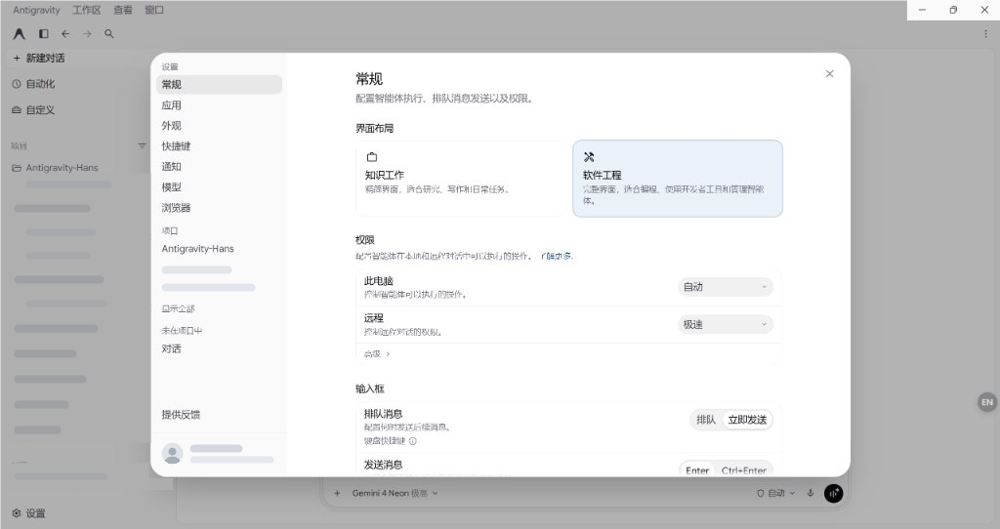
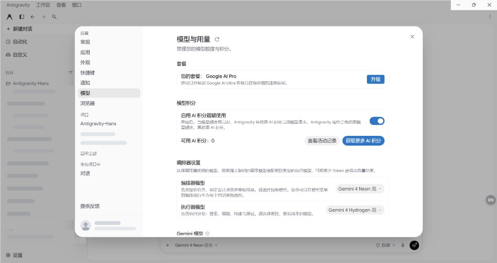

<div align="center">

# Antigravity 汉化工具 (Antigravity-Hans)

专为 **Google Antigravity** 及 **Antigravity IDE** 开发的零改包中文汉化工具

单文件开箱即用 · 无需 Node.js / Python · 不破坏官方签名 · 一键切换中英文

[](https://github.com/yuexps/Antigravity-Hans/releases/latest)
[](https://github.com/yuexps/Antigravity-Hans/releases)
[](https://github.com/yuexps/Antigravity-Hans/stargazers)
[](https://github.com/yuexps/Antigravity-Hans/actions/workflows/ci.yml)
[](#快速使用)

**适配版本**：**Antigravity `2.36.0`** 与 **Antigravity IDE `2.8.0`**

[效果预览](#效果预览) · [快速使用](#快速使用) · [方案对比](#社区汉化方案对比) · [汉化模式与切换](#汉化模式与切换) · [命令行参数](#命令行参数) · [常见问题](#常见问题)

</div>

## 效果预览





## 快速使用

前往 [Releases](../../releases) 下载对应平台单文件（未测试最新构建见 [GitHub Actions Artifacts](https://github.com/yuexps/Antigravity-Hans/actions/workflows/test.yml)）：

- **Windows**：双击 `antigravity-hans-windows-amd64.exe` 按菜单选择。
- **macOS**：`chmod +x antigravity-hans-macos-* && ./antigravity-hans-macos-arm64`（Intel 用 `amd64`）。
- **Linux**：`chmod +x antigravity-hans-linux-* && ./antigravity-hans-linux-amd64`（ARM64 用 `arm64`，兼容 `.deb` / `.rpm` / Arch AUR / `.tar.gz`）。

> 首次使用 IDE 时，工具会自动检测并提示安装[官方简体中文语言包](https://marketplace.visualstudio.com/items?itemName=MS-CEINTL.vscode-language-pack-zh-hans)，以保证菜单栏与编辑器完整汉化。

## 社区汉化方案对比

社区中有多个优秀的 Antigravity 开源汉化项目，技术路线与适用范围各有侧重，可按实际需求选择：

| 项目 | 技术路线 | 更适合的需求 |
| :--- | :--- | :--- |
| **Antigravity-Hans（本项目）** | CDP 实时无损注入 + IDE 可选静态补丁（Go 单文件） | 不想改动官方安装包与签名，零环境依赖跨三平台开箱即用；同时适配**桌面端与 IDE**，支持中英随时切换、「选项名保留英文」及自定义词表 |
| [antigravity-cn-community/Antigravity-Chinese-Localization](https://github.com/antigravity-cn-community/Antigravity-Chinese-Localization) | ASAR 补丁（预制 `app.asar` / 控制中心） | 仅需桌面端、希望覆盖原生菜单与托盘等静态界面，且不介意随版本更新核对版本号重打补丁（macOS 改包会破坏官方签名） |
| [qqxpee/antigravity2-cn](https://github.com/qqxpee/antigravity2-cn) | 纯 Node.js 本地解包重包 `app.asar` | 仅需桌面端或需要繁体中文，本机已有 Node.js 环境，且不介意改包并在官方更新后重跑脚本 |
| [Ace2025001/antigravity-desktop-zhcn](https://github.com/Ace2025001/antigravity-desktop-zhcn) | 内置运行环境 + 应用内汉化中心 | Windows / Apple Silicon Mac 桌面端用户，希望带图形化设置中心与更新后自动重汉化（暂不含 Linux、Intel Mac 与 IDE，且涉及修改或复制应用包） |
| [yiheng8023/antigravity-chinese](https://github.com/yiheng8023/antigravity-chinese) | ASAR 补丁 + VS Code 扩展补丁 | 需要在普通 VS Code（含远程 VS Code Server）中一并汉化 Antigravity 扩展，本机已有 Node.js 且不介意更新后重跑补丁（不含独立 IDE） |
| [guuguo/antigravity-zh-launcher](https://github.com/guuguo/antigravity-zh-launcher) | 多语言无损启动器 | 需要日/韩/繁中等 9 国多语言，或希望联动规则修改 AI 回复语言（仅面向 Windows / macOS 桌面端，不含 Linux 与 IDE） |

### 为什么选 Antigravity-Hans

- **零改包、保签名，升级省心**：动态模式通过本机 CDP 实时汉化，不修改官方安装目录与 `app.asar`；macOS 不涉及重签名与更新校验失效，Antigravity 常规更新后无需反复打补丁。
- **单文件零依赖，全平台覆盖**：Go 编译单文件开箱即用，无需安装 Node.js 或 Python，原生覆盖 Windows、macOS（Apple Silicon / Intel）与 Linux（x64 / ARM64）。
- **桌面端与 IDE 双端同步维护**：一套工具同时适配 Antigravity 桌面端与 Antigravity IDE，IDE 还可选免后台常驻的静态补丁，并自动引导安装微软官方简体中文语言包。
- **兼顾中文易读与英文术语习惯**：悬浮圆钮支持一键瞬切中/英文，可勾选「选项名保留英文」（权限模式、推理强度等保留英文，说明保持中文），并支持通过自定义名单微调任意译法。
- **正文严格隔离，跨平台回归校验**：自动避开代码编辑区、用户输入及智能体思考与回复正文，不误改内容；正式版均附 `SHA256SUMS` 并经 Windows / macOS / Linux 三平台 CI 回归测试。

## 汉化模式与切换

- **动态汉化（推荐）**：通过 CDP 实时翻译，不改动安装目录；支持普通版 Swarm 面板及 IDE 智能体/独立设置页面，可配合 `--shortcut` 生成一键启动图标。
- **静态补丁（仅 IDE）**：通过 `workbench.html` + Electron 主进程跨域子帧钩子（`out/main.js`）实现一劳永逸全界面汉化（含智能体侧边栏与 Antigravity 设置页），无需后台监视器，支持一键还原（Linux 系统目录需 `sudo`；IDE 升级后重跑 `--patch` 即可）。
- **中英切换按钮**：汉化生效后窗口右下角会出现半透明圆钮，单击切换中/英文，拖动可调整并记住位置，**双击或右键**可打开菜单勾选「**选项名保留英文**」（中文界面下保留对话权限及模型推理强度 `Extra High / High / Medium / Low` 等英文选项名）。

### 自定义翻译名单

在程序同目录放置 `custom-translations.txt`（参考 [resources/custom-translations.example.txt](resources/custom-translations.example.txt)），每行一条，整段匹配（不区分大小写），优先级高于内置预设：

```text
# 只写英文：保留原文不翻译
Request Review
# 英文 = 译文：自定义译法
Turbo = 快速模式
```

- Windows 需显式传入 `--trust-custom-translations`（生成快捷方式时同样附带该参数以保留配置）；macOS 自动校验文件属主与写权限。
- 修改名单后，动态模式执行 `antigravity-hans --stop` 后重连生效；静态模式需关闭 IDE 后重新执行 `--patch`。

## 命令行参数

<details>
<summary>展开查看命令行参数与 Windows 自动代理说明</summary>

```bash
# 启动汉化
antigravity-hans --app                 # 动态汉化 Antigravity
antigravity-hans --ide                 # 动态汉化 Antigravity IDE
antigravity-hans --patch               # 静态补丁管理（仅支持 IDE）
antigravity-hans --app --attach-only   # 仅连接已有调试端口，不重启应用
antigravity-hans --ide --attach-only   # 仅连接 IDE 已有调试端口

# 桌面快捷方式
antigravity-hans --shortcut            # 为两者生成一键汉化快捷方式（可加 --app 或 --ide）

# Windows 自动代理
antigravity-hans --app --with-proxy             # 读取代理并启动 Antigravity
antigravity-hans --ide --with-proxy             # 读取代理并启动 Antigravity IDE
antigravity-hans --shortcut --app --with-proxy  # 创建「Antigravity 中文（代理）」快捷方式，可换成 --ide

# 维护与自定义
antigravity-hans --stop                                 # 结束汉化监视器
antigravity-hans --trust-external-overlay               # 显式信任同目录外部汉化脚本
antigravity-hans --app --trust-custom-translations      # 显式信任同目录自定义翻译名单
```

Windows 主菜单和快捷方式菜单均提供「自动代理」选项。每次代理启动优先读取当前用户已启用的 Windows 手动代理，其次读取 `HTTP_PROXY`、`HTTPS_PROXY`、`ALL_PROXY`。如果没有固定代理地址（例如仅设置了 PAC），或代理端口无法连接，启动器会在退出已有应用前提示。使用普通启动时，应用仍按原有方式读取代理设置。

代理设置仅传递给新启动的应用及其子进程，本机 CDP 连接保持直连。切换启动方式或在代理地址变更后重新读取时，如果已有汉化监视器运行，请先执行 `antigravity-hans --stop`，再从对应入口启动。`--with-proxy` 与 `--attach-only` 互斥。

</details>

## 常见问题

- **官方更新后汉化会失效吗？**：动态模式不改原包，升级后一般仍可用（仅新文案待词库补齐）；IDE 静态补丁升级后重跑一次 `--patch` 即可。
- **如何更新汉化工具？**：执行 `antigravity-hans --stop`，下载新版覆盖原程序后重启（IDE 静态补丁需重跑 `--patch`）。
- **如何彻底卸载、恢复原版？**：动态模式未改原应用，执行 `--stop` 后直接删除本程序和快捷方式即可；静态补丁先在 `--patch` 菜单选「还原官方状态」。
- **能让 AI 助手帮我安装吗？**：可以，将下方指令发给 Antigravity 或其他支持终端的 AI 助手即可：

  ```text
  帮我安装 https://github.com/yuexps/Antigravity-Hans ：按当前系统从最新 Release 下载对应单文件放到合适目录，并为我生成中文快捷方式（不要修改 Antigravity 安装目录）。
  ```

- **杀毒软件误报（火绒 / Defender / 360 等）**：未签名 Go 单文件常触发启发式误报。下载后按 Release 页 `SHA256SUMS` 核对哈希一致即可放行，或自行源码编译。
- **macOS 快捷方式未生效**：查看监视器日志 `~/Library/Logs/antigravity-hans.log`。
- **提示监视器已在运行 / 更新后仍是旧词库**：先执行 `antigravity-hans --stop` 结束旧监视器，再重新启动。
- **Windows 退出超时或后台进程残留**：无可见窗口的后台进程会在交互模式下提示确认结束，无交互快捷方式（`--nogui`）会直接清理已校验的同会话无窗口残留进程；若仍有可见窗口则会中止重启，请保存后手动退出。

## 源码编译与贡献

需要 **Go 1.27.4+**（词库维护与回归测试需 Node.js）：

```bash
./build.sh                                # Unix 交叉编译全平台产物到 dist/
build.bat                                 # Windows 交叉编译全平台产物到 dist/
pwsh -File .\tools\build-windows.ps1      # 仅构建 Windows 本地测试版
```

欢迎提交 PR 补充词条或适配新版本。项目结构、词库工具流（`tools/dict.mjs`、`tools/build-overlay.mjs`）与提交前校验命令见 [AGENTS.md](AGENTS.md) 与 [适配技能](.agents/skills/antigravity-hans-adaptation/SKILL.md)。

## Star History

<a href="https://www.star-history.com/?repos=yuexps%2Fantigravity-hans&type=date&legend=top-left">
  <picture>
    <source media="(prefers-color-scheme: dark)" srcset="https://api.star-history.com/chart?repos=yuexps/antigravity-hans&type=date&legend=top-left&theme=dark" />
    <source media="(prefers-color-scheme: light)" srcset="https://api.star-history.com/chart?repos=yuexps/antigravity-hans&type=date&legend=top-left" />
    
  </picture>
</a>

## 致谢

- 感谢所有为本项目提交代码、文档、测试、Issue 的贡献者。

<a href="https://github.com/yuexps/Antigravity-Hans/graphs/contributors">
  
</a>
